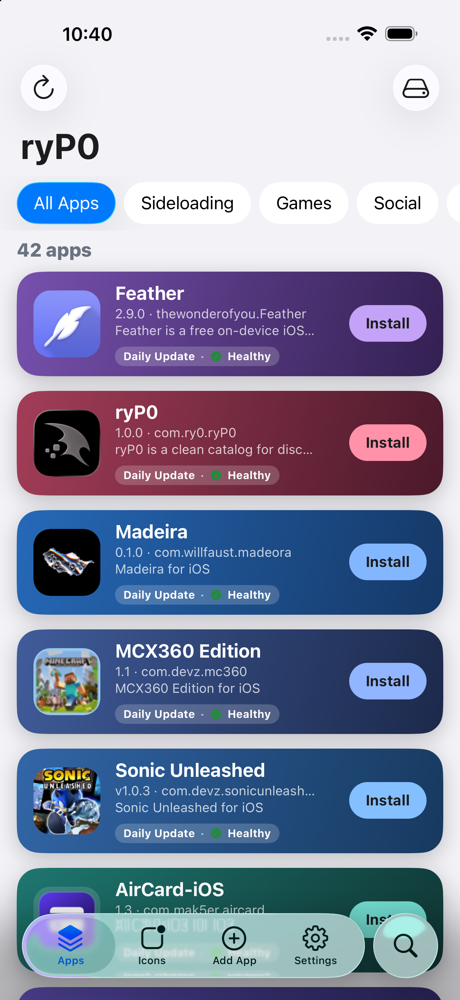
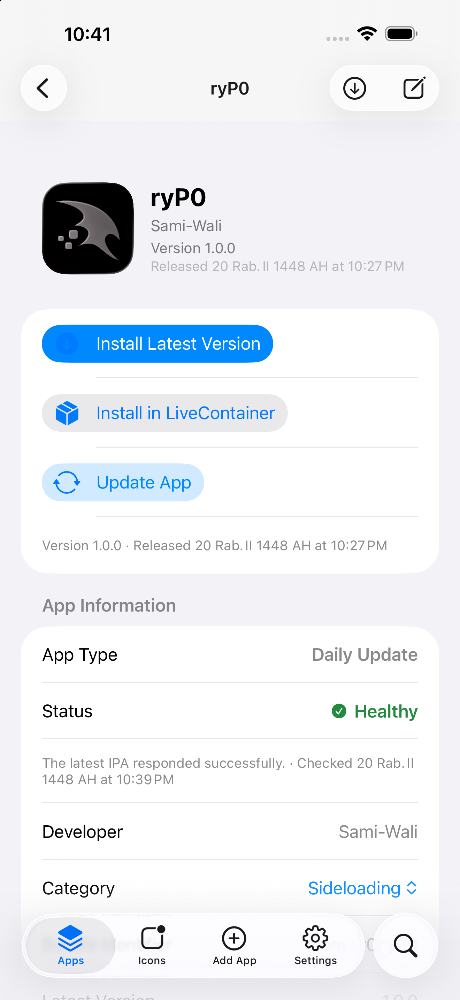
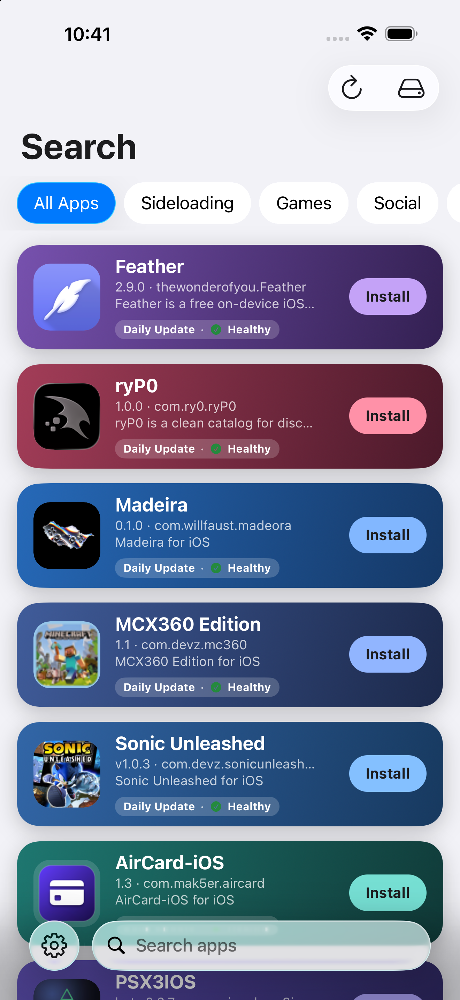

<div align="center">


# ryP0

### Discover beyond the usual.

<i>Discover, download, and keep supported apps automatically up to date.</i>

<br>

<h6 align="center">

  <a href="https://discord.gg/ckdKNVe7Z5">
    
  </a>

  <a href="https://github.com/Sami-Wali/ryP0/stargazers">
    
  </a>

  <a href="https://github.com/Sami-Wali/ryP0/releases">
    
  </a>

  <br />

</h6>

[](https://github.com/Sami-Wali/ryP0/releases)
[](#)

<br>

</div>

---

## Features

- **Automatic Updates** — supported apps automatically receive new versions when available.
- **Simple Catalog** — discover independent iOS software in one place.
- **Direct Downloads** — access available IPA releases directly.
- **Original Sources** — quickly open the original developer or project source.
- **Automatic Catalog Refresh** — new versions and metadata can appear without updating ryP0 itself.
- **LiveContainer Support** — designed to work smoothly with LiveContainer workflows.


### Browse and discover

- Search apps and filter the catalog by category.
- View app descriptions, developers, icons, bundle identifiers, categories, source status and minimum iOS requirements when provided.
- Read declared permissions and entitlements when included in the source.
- Open the original GitHub project and share available download links.
- Refresh the catalog using pull-to-refresh or the Refresh button.

### Versions and release notes

- Browse and download older versions retained by the source.
- Filter available versions by **Release**, **Pre-release**, **Beta**, **Alpha**, **Nightly**, **Tag** and **Actions**.
- Check version numbers, release dates and IPA sizes when available.
- Expand or collapse version history and open **Patch Notes** for individual releases.
- Use **New Releases** to see the latest dated release per app, newest first, with search and a Favorites filter.
- Supported external GitHub-based sources can supplement their saved catalog with live release history and cached fallback results.

### Downloads, background transfers and Live Activities

- Download IPA files inside ryP0 with progress, downloaded bytes and clear transfer states.
- Cancel active downloads and retry failed or cancelled transfers.
- Keep download history and completed IPA files across app launches.
- Reuse an already downloaded IPA instead of downloading the same file again.
- Continue managed downloads while a normally installed app is suspended in the background, subject to iOS scheduling.
- Follow supported downloads on the Lock Screen and Dynamic Island through **Live Activities**, and tap an activity to open Downloads.
- **Share** the saved IPA as a local file, or use **Save** to choose a destination in the Files app, without downloading it again.
- Swipe a download to delete its local IPA and history entry. Copies exported to Files and installed apps are not removed.

### Installer and container integrations

- Send available IPA links to **LiveContainer**, **AltStore** or **SideStore**.
- Show a **Return to LiveContainer** shortcut only when ryP0 is running inside LiveContainer.
- Detect when ryP0 occupies the primary LiveContainer and explain how to use LiveContainer 2 or download and import the IPA manually.
- Offer experimental **Nyxian** installation in supported hosted environments, with progress and a saved-file export fallback.

### Sources and offline access

- Add compatible HTTPS JSON app sources, including multiple source URLs at once or pasted from the clipboard.
- Switch sources from the Apps toolbar without replacing the built-in catalog.
- Rename or edit saved sources, copy their URLs and remove added sources from the device without modifying the remote repository.
- Browse the last successfully saved catalog and cached icons when offline; cached release history remains available when a live lookup fails.
- Clear cached catalogs, icons and release history while keeping sources, settings, sign-in and downloaded IPA files.

### Favorites and quick actions

- Add or remove favorites from app details or an app card's long-press menu.
- Filter the Apps page to favorites only; favorites are stored locally and separately for each source.
- Long-press an app card to copy its latest IPA link or bundle ID, or open its GitHub project.
- Save an app's original icon to Photos or copy its icon URL.

### App requests

- Suggest apps from a **GitHub project**, **JSON app source**, **IPA link** or supported public **Telegram** link.
- Browse a JSON source inside Add App, search its apps, select multiple apps and choose a category for each request.
- Include request details where needed, and retry unsent source selections without resubmitting apps already acknowledged.
- Follow requests submitted on the device in **My Requests**, including available review/import status and rejection reasons.
- Public requests are reviewed before publication and do not require an administrator's GitHub credentials.

### Appearance and native controls

- A native **SwiftUI/UIKit** interface for iPhone and iPad.
- Choose **System**, **Light** or **Dark** appearance.
- Personalize the accent with **Blue**, **Purple**, **Cyan**, **Red**, **Rose** or **Altstore**.
- Native **Liquid Glass** action controls on iOS 26, with compatible styling on older supported iOS versions.
- Icon-inspired app-card colors and gradients.
- Installer symbols and GitHub, Discord and YouTube brand icons that follow the accent color.
- Dismiss the keyboard interactively while scrolling, or drag the request/import action area down to close it.
- Accessibility labels, adaptable download action layouts for larger text and reduced-motion-aware favorites filtering.
- Open the GitHub project, Discord community and YouTube channel from Settings.

### Admin edition — separate, owner-authorized build

The Admin edition includes the browsing and download features above, plus authorized catalog-management tools. These controls are not available in the regular public edition.

- Sign in through GitHub, keep the session in the device Keychain and sign out from Settings.
- Edit app names, developers, descriptions, subtitles, icons, tint colors and categories.
- Add manual version entries, duplicate catalog entries, reorder apps and remove apps from the managed catalog.
- Queue cleanup of an app's updater configuration and generated workflow when removing it; hosted IPA assets are kept.
- Create, rename, reorder and remove categories.
- Import from a direct IPA URL, GitHub project, JSON source, public Telegram source or local IPA file.
- Review extracted apps from a JSON source and select multiple apps with individual categories before queueing imports.
- Choose supported GitHub release/build channels, an exact tag or Actions commit where applicable, delivery mode, update policy and retained version-history count.
- Queue validated imports and open their workflow results; queueing is not the same as completed publication.
- Review app requests, edit their details, approve and queue imports, retry failed imports, reject requests with a reason or archive them.
- Manage updater profiles, edit source and delivery settings, pause or enable updates, remove an updater without deleting its public app, and queue checks for one app or all configured apps.
- Upload icons from Photos, Files or an HTTPS URL; choose icons from the Admin-only library, rename labels, copy URLs, save images or delete gallery items.

> [!IMPORTANT]
> Automatic updates refer to versions published in the catalog, not automatic replacement of apps installed on your device. Available versions, channels, metadata and patch notes depend on each source. Installer integrations require the corresponding installer and a compatible IPA.
>
> Background downloads and Live Activities depend on iOS and a supported, normally installed/signed build. Force-quitting ryP0 stops background transfers; reopen it and use Retry. Container-hosted apps may not receive the same background or widget lifecycle, and iOS controls when Live Activities refresh.
>
> Features vary by installed build and iOS version. Nyxian integration is experimental; publishing an app or accepting an install request does not guarantee that it will run.

---

## Screenshots

<p align="center">
  
  &nbsp;
  
  &nbsp;
  
</p>

---

## Download

> [!NOTE]
> **LiveContainer users:**  
> Convert **ryP0 to a Shared App** and run it through **LiveContainer 2**.
>
> This keeps **LiveContainer 1** available so apps opened through ryP0 can be sent directly to your primary LiveContainer.

<br>

<h3 align="center">

<a href="https://altdirect.app/?url=https://raw.githubusercontent.com/Sami-Wali/ryP0-repository/main/repo.json">
  
</a>

&nbsp;

<a href="https://github.com/Sami-Wali/ryP0/releases/download/Release/ryP0-unsigned.ipa">
  
</a>

</h3>

---

## LiveContainer

For the recommended setup:

1. Open **ryP0** in LiveContainer.
2. Open **App Settings**.
3. Select **Convert to Shared App**.
4. Open **LiveContainer 2**.
5. Launch **ryP0** from LiveContainer 2.

This lets ryP0 stay open in LiveContainer 2 while LiveContainer 1 remains available for apps opened through ryP0.

---

## Raw source

```text
https://raw.githubusercontent.com/Sami-Wali/ryP0-repository/main/repo.json
