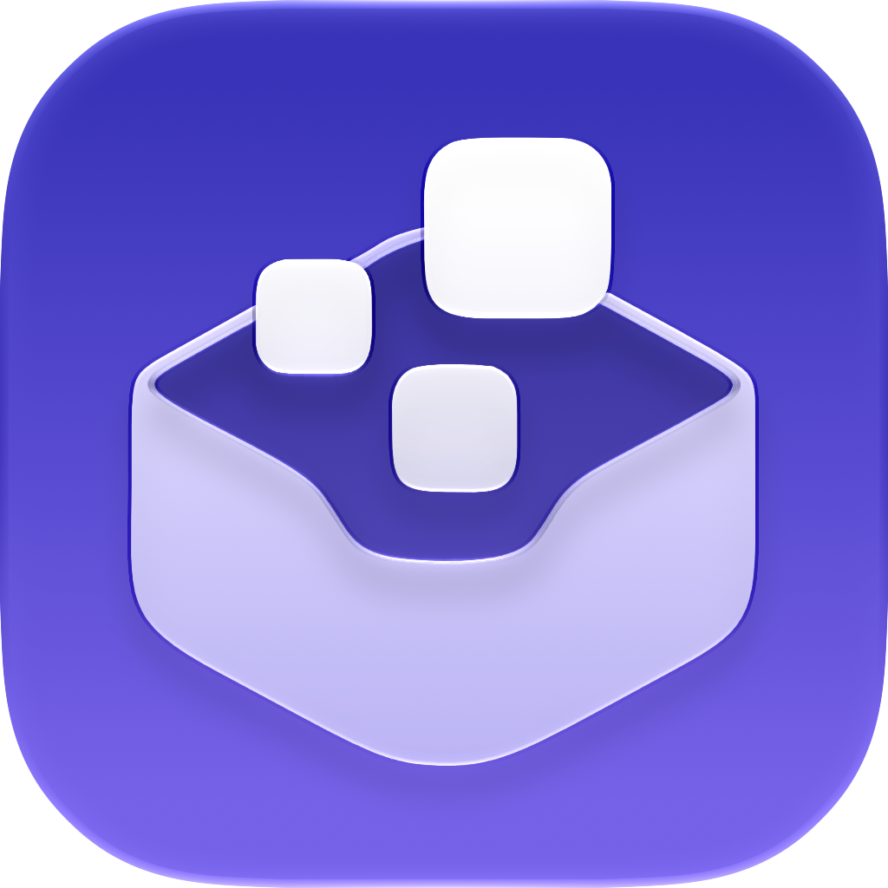
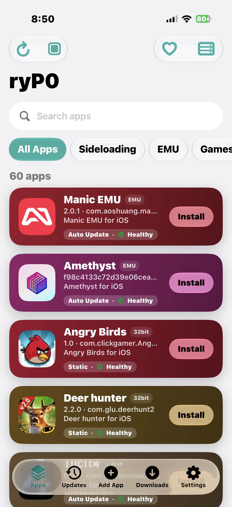
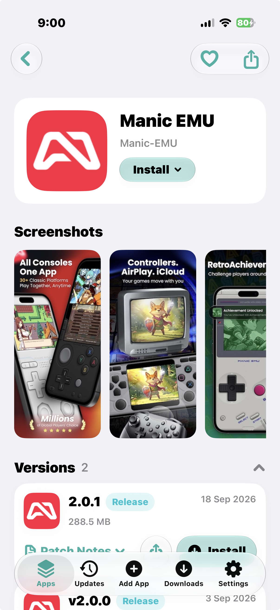
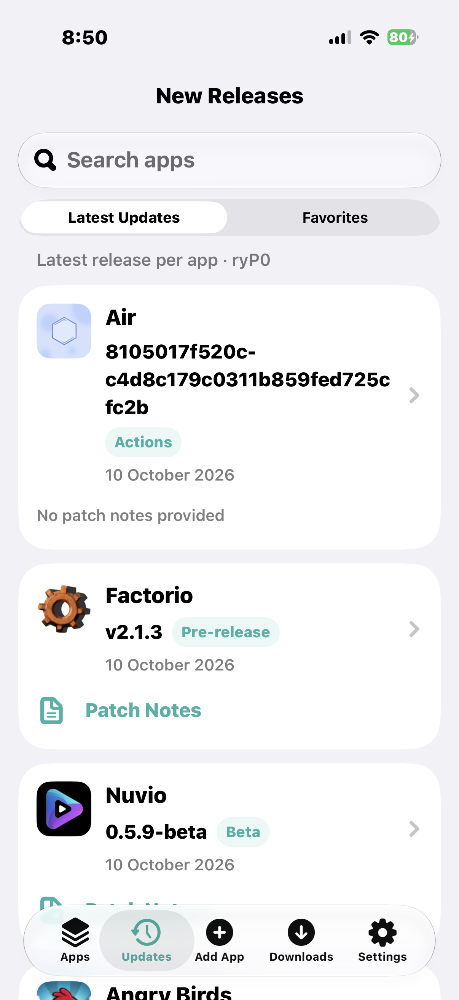
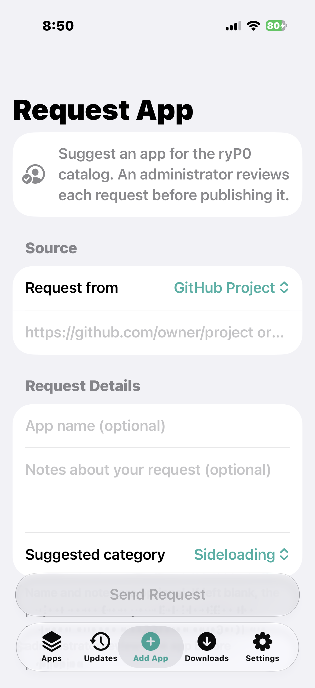
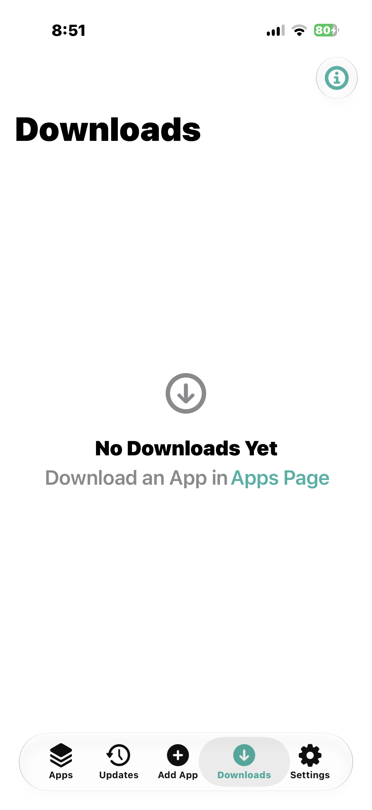
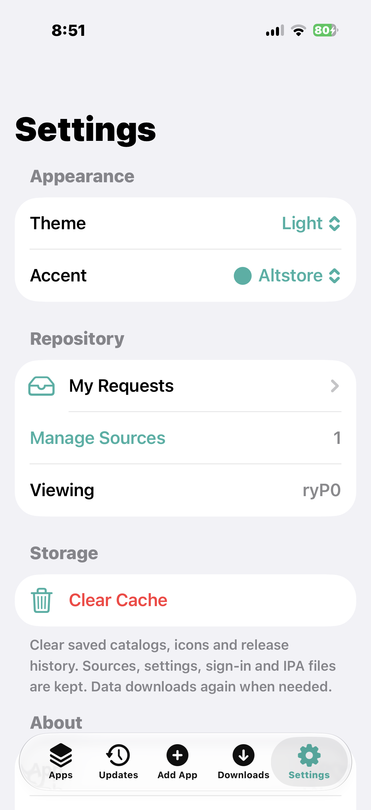
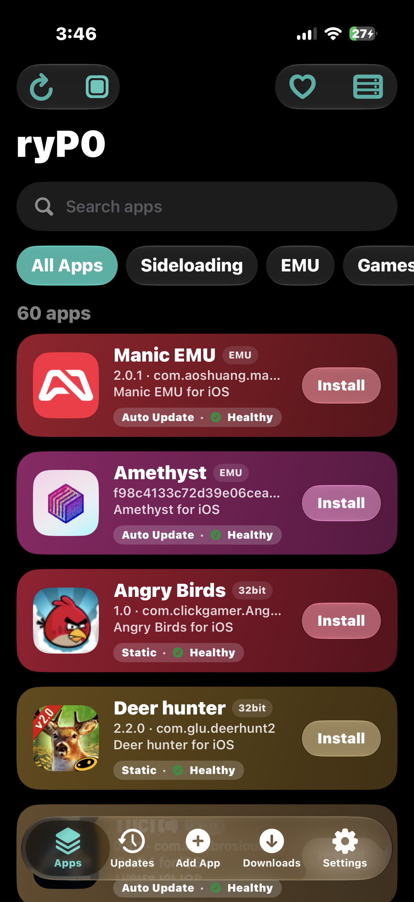
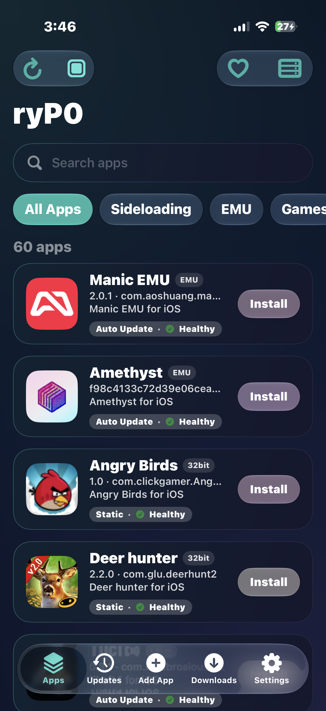

<div align="center">



# ryP0

### Discover beyond the usual.

<i>Discover, download, and keep supported iOS apps automatically up to date.</i>

<br>

<h6 align="center">

  <a href="https://discord.gg/ckdKNVe7Z5">
    
  </a>

  <a href="https://github.com/Sami-Wali/ryP0/stargazers">
    
  </a>

  <a href="https://github.com/Sami-Wali/ryP0/releases">
    
  </a>

  <br />

</h6>

[](https://github.com/Sami-Wali/ryP0/releases)
[](#)

<br>

</div>

---

## Features

- **Explore & Download** — Discover independent iOS apps, browse by category, and download IPAs directly.
- **Auto-Updating Catalog** — Real-time updates and releases without needing to update ryP0 itself.
- **Installer Integrations** — Direct 1-tap installation via **LiveContainer**,**zContianer** **AltStore**, **SideStore**, or **Zeus**.
- **Custom Repositories** — Add external HTTPS JSON repos with full offline browsing and caching.
- **Version Control & Notes** — Access historical releases, filter builds (Release, Beta, Alpha, Nightly), and view patch notes.
- **Community Requests** — Submit and track app suggestions via GitHub, JSON repos, or Telegram links.

> [!NOTE]
> Updates apply to catalog listings. Installer integration requires the respective tool installed and a compatible IPA.

---

## Screenshots

<table align="center">
  <tr>
    <td align="center" width="33%">
      <a href="assets/screenshots/1.PNG">
        
      </a>
    </td>
    <td align="center" width="33%">
      <a href="assets/screenshots/2.PNG">
        
      </a>
    </td>
    <td align="center" width="33%">
      <a href="assets/screenshots/3.PNG">
        
      </a>
    </td>
  </tr>
  <tr>
    <td align="center" width="33%">
      <a href="assets/screenshots/4.PNG">
        
      </a>
    </td>
    <td align="center" width="33%">
      <a href="assets/screenshots/5.PNG">
        
      </a>
    </td>
    <td align="center" width="33%">
      <a href="assets/screenshots/6.PNG">
        
      </a>
    </td>
  </tr>
</table>

---

## Themes

<table align="center">
  <tr>
    <th align="center" width="33%">Light</th>
    <th align="center" width="33%">Dark</th>
    <th align="center" width="33%">Aurora</th>
  </tr>
  <tr>
    <td align="center">
      <a href="assets/themes/Light.PNG">
        
      </a>
    </td>
    <td align="center">
      <a href="assets/themes/Dark.PNG">
        
      </a>
    </td>
    <td align="center">
      <a href="assets/themes/Aurora.PNG">
        
      </a>
    </td>
  </tr>
  <tr>
    <th align="center" width="33%">iOS 3</th>
    <th align="center" width="33%">Dynamic Theme 1</th>
    <th align="center" width="33%">Dynamic Theme 2</th>
  </tr>
  <tr>
    <td align="center">
      <a href="assets/themes/iOS%203.PNG">
        
      </a>
    </td>
    <td align="center">
      <a href="assets/themes/theme1.gif">
        
      </a>
    </td>
    <td align="center">
      <a href="assets/themes/theme2.gif">
        
      </a>
    </td>
  </tr>
</table>

---

## LiveContainer Setup

> [!TIP]
> **To send apps directly to LiveContainer 1:** Convert **ryP0** to a Shared App and run it through **LiveContainer 2**.

1. Open **ryP0** in LiveContainer.
2. Go to **App Settings** → **Convert to Shared App**.
3. Open **LiveContainer 2** and launch **ryP0**.

---

## Repository Source

```text
https://raw.githubusercontent.com/Sami-Wali/ryP0-repository/main/repo.json
